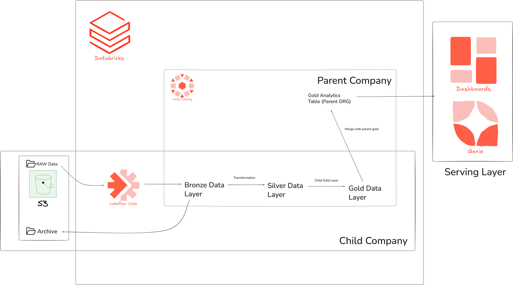
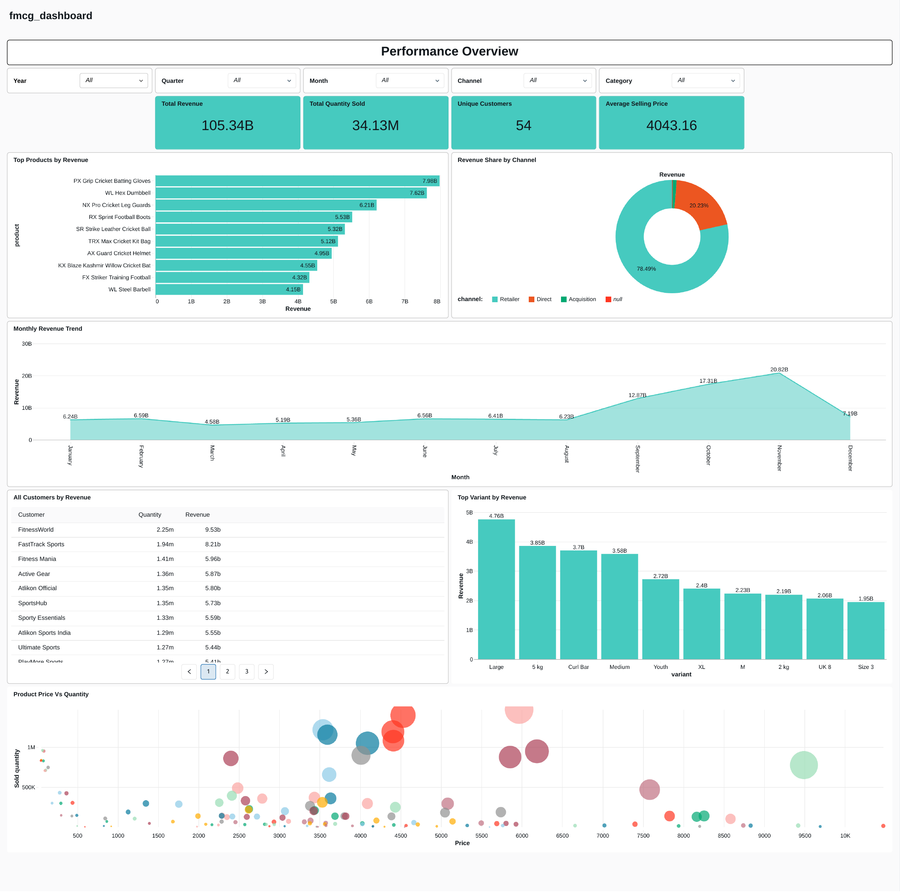

# FMCG Multi-Source Lakehouse Pipeline (Databricks, PySpark, Delta Lake)

An end-to-end Medallion (Bronze → Silver → Gold) data pipeline built on **Databricks Free Edition**, simulating a real-world scenario: a **parent FMCG company** acquiring a **child company (Sports Bar)** and needing to merge the acquired company's sales data into its own existing analytics model — on both a one-time (full load) and ongoing (daily incremental load) basis.

## Why this project

Most portfolio pipelines process a single clean dataset once. This one is built around two problems that come up constantly in real data engineering work:

1. **Merging two differently-shaped data models.** The parent and child companies track customers, products, and pricing differently. The pipeline standardizes the child's schema to match the parent's before merging — not just unioning tables.
2. **Full load vs. incremental load are not the same pipeline.** The child company lands daily order files. The project has a dedicated incremental notebook that detects only the newly arrived data, recomputes just the affected monthly aggregates, and merges those deltas into the parent's Gold fact table — instead of reprocessing all history every run.

## Architecture



- **Ingestion:** Raw CSVs land in S3 (`raw/`), get picked up by Databricks Lakeflow Jobs, and moved to an `archive/` path after processing.
- **Bronze:** Raw data loaded as-is into Delta tables, with `read_timestamp`, source `file_name`, and `file_size` captured for lineage, using Unity Catalog for governance.
- **Silver:** Data quality fixes and standardization (see below) applied per source.
- **Gold:** Child company's Gold layer is standardized to the parent's data model and **merged (upserted)** into the parent's existing Gold tables.
- **Serving:** A denormalized enriched view (`vw_fact_orders_enriched`) joins fact orders with date, customer, product, and price dimensions, feeding dashboards and ad-hoc querying (Genie).

## Data model

| Table | Type | Notes |
|---|---|---|
| `dim_customers` | Dimension | Parent model: `customer_code, customer, market, platform, channel` |
| `dim_products` | Dimension | Parent model: `product_code, division, category, product, variant` |
| `dim_gross_price` | Dimension | Latest non-zero price per product per year |
| `dim_date` | Dimension | Generated monthly calendar table |
| `fact_orders` | Fact | Grain: month × product × customer, `sold_quantity` |

The child company's raw data uses a different grain and different column names (`customer_id`/`customer_name`/`city`, daily order-level `order_qty`) and is transformed through Bronze → Silver → Gold before being aggregated to monthly grain and merged into the parent's fact table.

## Data quality handled in Silver

- Duplicate customer/product records dropped (`dropDuplicates` on business keys)
- Inconsistent city name spellings normalized via a mapping dictionary (`Bengaluruu` / `Bengalore` → `Bengaluru`, etc.), with remaining nulls resolved against a business-confirmed lookup
- Inconsistent casing fixed (`F.initcap`) on names and categories
- Spelling fix applied across product name/category (`Protien` → `Protein`) using `regexp_replace`
- Multiple incoming date formats in the pricing feed reconciled with `F.try_to_date` + `coalesce`
- `gross_price` validated: non-numeric values zeroed out, negative prices corrected to positive
- Orders with a missing `order_qty` dropped; non-numeric `customer_id` values mapped to a `999999` "unknown customer" bucket

## Full load vs. incremental load (the core design decision)

**Full load** (`3_fact_processing/1_full_load_fact.ipynb`)
Processes the entire historical order history once, aggregates to monthly grain, and does a one-time full merge into the parent's `fact_orders` Gold table.

**Incremental load** (`3_fact_processing/2_incremental_load_fact.ipynb`)
Runs on each new batch of daily order files:
1. Reads only the new files from the `landing/` path and moves them to `processed/` after ingestion
2. Loads them into a **staging table**, keeping the incremental batch isolated from full history
3. Identifies which calendar months are touched by the new data
4. Recomputes the monthly aggregate **only for those affected months** (not the whole table)
5. Performs a `MERGE` (`whenMatchedUpdateAll` / `whenNotMatchedInsertAll`) into the parent's Gold fact table — an idempotent upsert, so re-running the same batch doesn't duplicate data
6. Drops the staging tables as a cleanup step

This mirrors how production incremental pipelines behave: new data arrives daily, but only the affected aggregates get recalculated and merged, not the entire fact table.

## Dashboard

A Databricks SQL dashboard built on the enriched serving view, covering revenue, quantity sold, channel mix, monthly trend, top customers/products/variants, and a price-vs-quantity view.



Full dashboard export: [`dashboard/fmcg_dashboard.pdf`](dashboard/fmcg_dashboard.pdf)

## Tech stack

Databricks (Free Edition) · PySpark · Spark SQL · Delta Lake (MERGE, Change Data Feed, schema evolution) · Unity Catalog · Databricks SQL Dashboards

## Repository structure

```
notebooks/
  1_setup/                     catalog & schema creation, dim_date generation, shared utilities
  2_dimension_processing/      customers, products, pricing — Bronze → Silver → Gold → merge with parent
  3_fact_processing/           full load and incremental load of the orders fact table
sql/
  vw_fact_orders_enriched.sql  denormalized serving-layer view powering the dashboard
  incremental_data_parent_company_query.sql
dashboard/
  fmcg_dashboard.pdf           full dashboard export
  dashboard_screenshot.png
architecture/
  project_architecture.png
  databricks_project.excalidraw   editable source for the architecture diagram
sample_data/
  parent_company/              parent's existing dimension & fact tables (full)
  child_company/                child company's raw dimension files (full) + a sample of daily order
                                 landing files (full 6-month landing history was used to build and
                                 run the pipeline; a representative sample is kept here for repo size)
```

## Notes

- Built entirely on **Databricks Free Edition** — no cloud billing required to reproduce.
- Paths in the notebooks (`s3://...`, `/Workspace/consolidated_pipeline/...`) reflect the original development workspace and would need to be repointed to run elsewhere.
- This is a personal project built to practice lakehouse engineering patterns (Medallion architecture, incremental MERGE pipelines, cross-source data model reconciliation) alongside professional experience in Teradata-to-BigQuery data warehouse migrations.
